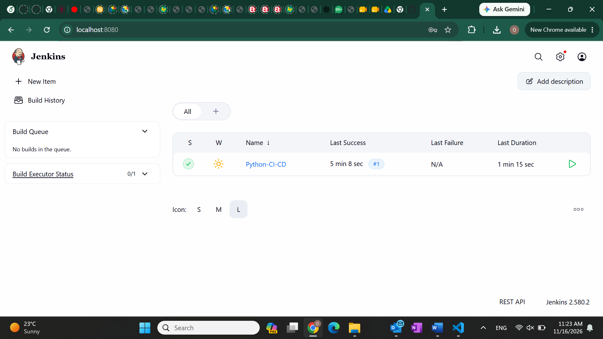

# Lab 10 report

Name: Omar Khalil  
GitHub: omk166  
Repository: https://github.com/omk166/OmarKhalil_lab10

## Changes

The Part 3 pipeline is implemented in `Jenkinsfile_Omar_Khalil`. It creates a
virtual environment, installs dependencies, lints Python code, tests the
personalized greeting, and deploys a runnable copy of the application.
The greeting and its test both use `Hello, World from Omar Khalil!`, correcting
the mismatch between the starter application and the handout's expected test.
The requirements include pytest as well as the added analysis tools.

For Part 4, the Coverage stage measures both statements and branches for
`app.py` and `deploy.py`. It exports XML and HTML reports and enforces 100%
coverage. The Security Scan stage runs Bandit on both production files and
fails on findings. The Deploy stage copies the application into a local
deployment directory and executes that copy. Tests also verify redeployment
replaces an outdated application. Jenkins archives the deployment and reports
before cleaning its workspace.

## Local verification

Run on Windows with Python 3.13.7 using the pinned requirements:

| Check | Observed result |
| --- | --- |
| flake8 | Passed, no violations |
| pytest | 6 passed |
| coverage | 22 statements and 4 branches covered; 100% total |
| Bandit | Passed, no findings |
| deployment | Created deployment/app.py and executed successfully |

Observed coverage output:

```text
Name        Stmts   Miss Branch BrPart  Cover
--------------------------------------------
app.py          6      0      2      0   100%
deploy.py      16      0      2      0   100%
--------------------------------------------
TOTAL          22      0      4      0   100%
```

Observed deployed application output:

```text
Hello, World from Omar Khalil!
```

## Jenkins build

Jenkins **2.580.2**, running with Temurin Java **21.0.13**, executed job
`Python-CI-CD`, build **#1**, on **16 November 2026**. The build fetched the
Jenkinsfile and source from GitHub, commit
`a108f990a3248f2180f4b5f1e7daf45e118552a2`.

- Result: **SUCCESS**
- Duration: **75.835 seconds**
- Local build URL: http://localhost:8080/job/Python-CI-CD/1/
- Stages passed: Setup, Lint, Test, Coverage, Security Scan, Deploy.
- Tests: **6 passed**, recorded by Jenkins' JUnit publisher.
- Coverage: **100%** statement and branch coverage for both production files.
- Bandit: **0 findings**; no scan errors or skipped tests.
- Deployment: application copied and executed successfully.
- Reports and deployed app archived before workspace cleanup.

Actual Jenkins output excerpts:

```text
6 passed in 0.23s
TOTAL          22      0      4      0   100%
Hello, World from Omar Khalil!
Recording test results
Archiving artifacts
Finished: SUCCESS
```

The complete unedited Jenkins console output is saved in
[`evidence/jenkins-build-1-console.txt`](evidence/jenkins-build-1-console.txt).
The same directory contains the build metadata from Jenkins' API, the archived
JUnit test results, coverage XML, and Bandit JSON. The local Jenkins URL can be
opened on the lab machine; the committed evidence can be reviewed from GitHub.
Later documentation and evidence commits do not change the tested application,
tests, requirements, or Jenkinsfile.

## Screenshot proof

The following original screenshot, supplied by Omar Khalil, shows the local
Jenkins dashboard with a successful `Python-CI-CD` build **#1**, no failed build,
and a last duration of **1 minute 15 seconds**. The image is included unchanged.


